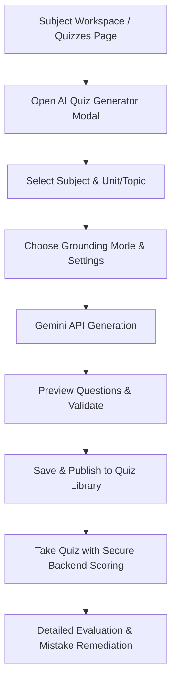

# StudySense — Smart Automatic Quiz Generation & Source Grounding

## 1. Overview

The StudySense Smart Quiz Generator enables automated generation of curriculum-aligned assessments grounded in institutional syllabi, uploaded study materials, or university benchmarks.

---

## 2. Supported Input Sources

1. **Entire Subject Syllabus**: Generates questions matching all units and learning objectives of the selected subject.
2. **Selected Unit**: Restricts question generation to a specific chapter or unit (e.g., *Unit 1: Process Management*).
3. **Selected Topic**: Focuses exclusively on a single topic with conceptual depth.
4. **Ingested Study Materials**: Grounds questions strictly in uploaded PDFs, lecture slides, or notes.
5. **Combined Mode**: Fuses uploaded notes with standard curriculum benchmarks to fill conceptual gaps.

---

## 3. Grounding Modes

| Grounding Mode | Description | Guardrails |
|---|---|---|
| **Mode A: Use My Materials Only** (`material_only`) | Restricts question generation to uploaded lecture notes, PDFs, and syllabus documents. | Rejects external hallucination; fails gracefully if materials lack sufficient coverage. |
| **Mode B: Curriculum & Syllabus Benchmark** (`general_knowledge`) | Uses official subject names, units, and curriculum standards as the basis for question creation. | Clearly labeled as curriculum-based benchmark testing. |
| **Mode C: Combined Materials + Curriculum** (`combined`) | Cross-references user notes with curriculum concepts. | Distinguishes notes-derived concepts from broad curriculum concepts. |

---

## 4. Question Formats & Marks

- **Multiple Choice Questions (MCQ)**: 1 mark per question, 4 options with single correct answer, server-side validated and scored.
- **Short Answer**: 2 to 5 marks per question with concise rubric criteria.
- **Mixed Formats**: Blend of MCQs and descriptive questions for assessment.

---

## 5. End-to-End Workflow

---

## 6. Security, Ownership & User Isolation

- **User Authentication**: Strict cookie-based JWT authentication enforced on all quiz and question endpoints.
- **Ownership Verification**: All subject IDs, topic IDs, and question bank references verified against `req.user.id`.
- **Server-Side Scoring**: MCQ answer keys are never delivered to the client during assessment; evaluation is conducted securely on backend submission.
- **Mistake Book Deduplication**: Incorrect responses create or update unique mistake items per user and question.
